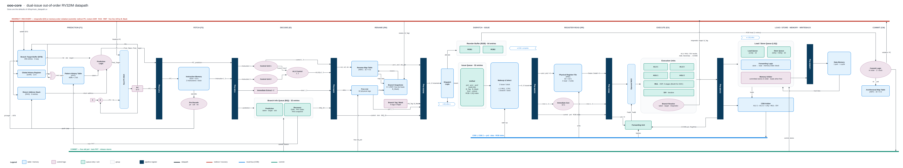

# ooo-core

A **dual-issue out-of-order RV32IM processor** in SystemVerilog. It fetches, renames and commits
two instructions per clock, runs them out of order behind a 12-stage pipeline, and retires them in
program order. Every committed instruction is checked against the Spike ISA simulator.



Editable source: [`docs/diagrams/ooo_core_datapath.drawio`](docs/diagrams/ooo_core_datapath.drawio) (open in draw.io). Previous diagram: [`docs/images/processor_architecture.png`](docs/images/processor_architecture.png).

## Design in six sentences

1. A gshare predictor (12-bit global history, 4096-entry PHT), a 2-way 256-entry BTB and an 8-entry return
   address stack pick the next fetch bundle of two instructions.
2. Decode records every branch in the branch information queue (BIQ), which trains the PHT only when the
   branch commits, so wrong-path branches never train it.
3. Rename maps 32 architectural registers onto 64 physical ones (map table, free list, and a snapshot for each
   of up to 8 unresolved branches to recover from a misprediction).
4. Dispatch writes the 64-entry ROB, the 32-row issue queue and the load / store queues (16 loads, 32 stores);
   ready instructions issue out of order to two ALUs, a pipelined multiplier, a divider and two AGUs.
5. Loads run ahead of older stores with store-to-load forwarding; a load that read too early is caught when the
   store's address arrives, and everything not yet committed is flushed and fetched again.
6. Two results per clock go out on the common data bus; the ROB commits up to two instructions per clock and
   writes stores to memory in order.

The full description is in [`docs/spec/architecture.md`](docs/spec/architecture.md), the reasons behind each
choice in [`docs/decisions/`](docs/decisions/), and measured results in [`docs/scorecard.md`](docs/scorecard.md).

## Results

| | |
|---|---|
| ISA | RV32IM (no CSRs, traps or `fence`; aligned accesses only) |
| CoreMark | **3.53 CoreMark/MHz** (IPC 1.02) |
| Dhrystone | **1.30 DMIPS/MHz** (IPC 1.22) |
| Correctness | identical to Spike on 111 directed and random programs in 3 configurations (one known reset bug, see [`CHANGELOG.md`](CHANGELOG.md)), CoreMark, Dhrystone; RISCOF RV32I + RV32M 47/47 |
| FPGA (Artix-7 xc7a100t-1) | ≈ 30 MHz routed today; frequency work towards 150 MHz in progress |

Memories are ideal one-cycle RAMs for now. Details and sources: [`docs/scorecard.md`](docs/scorecard.md).

## Status

| Block | Folder | State |
|---|---|---|
| Prediction and fetch (PC, gshare, BTB, RAS, instruction memory, pre-decode) | `rtl/frontend/` | RTL + unit tests |
| Decode (control unit, immediates, BIQ) | `rtl/decode/` | RTL + unit tests |
| Rename (map table, free list, branch snapshots) | `rtl/rename/` | RTL + unit tests |
| Dispatch, issue queue, register read, physical register file | `rtl/issue/` | RTL, tested in the whole core |
| Execute (ALUs, forwarding, DSP / Booth multiplier, divider, CDB arbiter) | `rtl/execute/` | RTL + unit tests |
| Load / store queue, data memory | `rtl/memory/` | RTL + unit tests |
| ROB and commit | `rtl/commit/` | RTL + unit tests |
| Whole core | `rtl/top/` | matches Spike, RISCOF RV32IM passes; one known bug: LSQ writes memory during reset |
| 150 MHz on xc7a100t-1 | `fpga/` | in progress |
| Caches, CSRs and traps, Linux | | planned (see the versions in [`docs/git-workflow.md`](docs/git-workflow.md)) |

Open work is tracked in the GitHub issues.

## Repository layout

```
rtl/              synthesizable SystemVerilog, one folder per pipeline section;
                  rtl/rtl.f lists every file (used by simulation, lint and Vivado)
sim/unit/         module testbenches (run_unit.sh)
sim/core/         whole core against Spike: directed asm / C programs and a random program generator
sim/riscof/       RISC-V architectural tests (RISCOF plugins for the core and Spike)
sim/bench/        CoreMark and Dhrystone ports and runner
sim/smoke/        tb_main_datapath: runs one hex program and dumps a waveform
sim/scripts/      run_all.sh: the whole regression, exit 1 on failure
fpga/             Vivado scripts: synthesis, place and route, timing maps (Artix-7 xc7a100tcsg324-1)
docs/spec/        architecture, parameters, interfaces
docs/decisions/   one file per design decision and why
docs/scorecard.md measured performance, correctness, resources and frequency
```

Full map: [`STRUCTURE.md`](STRUCTURE.md).

## Quick start

Tools: Verilator 5, `riscv32-unknown-elf-gcc` (rv32im), Spike, Python 3; Vivado for synthesis.

```bash
# unit tests + the core against Spike on directed and 100 random programs
sim/scripts/run_all.sh

# also the small / Booth configurations and CoreMark / Dhrystone checked against Spike
sim/scripts/run_all.sh --full

# benchmarks only (cycles, IPC, CoreMark/MHz, DMIPS/MHz)
sim/bench/run_bench.py

# synthesis + place and route of the core
cd fpga && vivado -mode batch -source synth.tcl
```

More commands and options: [`sim/README.md`](sim/README.md).

Generated files (`sim/build/`, `fpga/build/`, waveforms, Vivado checkpoints and logs) are never committed;
rebuild them with the scripts above.

## How we work

Read [`CONTRIBUTING.md`](CONTRIBUTING.md) and [`docs/git-workflow.md`](docs/git-workflow.md)
before your first commit: one issue per task, one branch per issue, a pull request into
`main`, and a review before merging. Every PR runs the CI checks (RTL lint, unit tests, no generated or
large files). Changes and versions are listed in [`CHANGELOG.md`](CHANGELOG.md).

## Team

| Name | Role | GitHub |
|---|---|---|
| Mutahir Ahmed Siddiqui | Research Fellow @ Micro Electronics Research Lab - UITU | @HafizMutahirAhmed |
