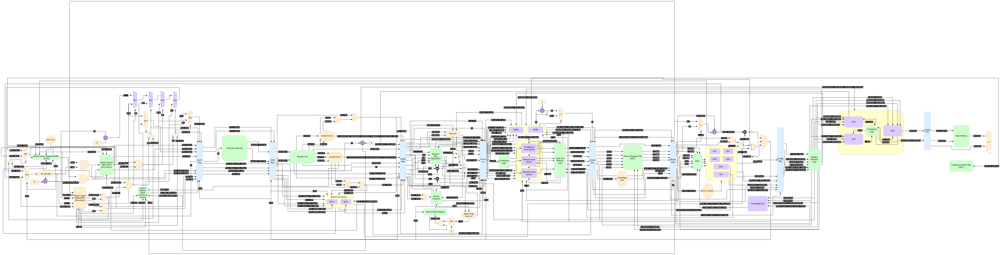

# Architecture

## ISA and limits

- RV32IM. `ecall`, `ebreak`, CSR instructions and `fence` are ignored; there are no traps or interrupts.
- Separate instruction and data memories, ideal (one-cycle, synchronous read): `IM` and `DataMemory`.
- Memory accesses must be aligned.
- The program starts at `RESET_PC`; a simulation ends when the program writes the `tohost` word
  (`sim/core/link.ld`, `crt0.S`).

## Pipeline

Two instructions per clock from fetch to commit, 12 stages:

| # | Stage | Folder | What it does |
|---|---|---|---|
| 1 | Prediction | `rtl/frontend/PD_Stage.sv` | next fetch PC from the BTB, gshare (GHR ⊕ PC → PHT) and the RAS; redirects from EX and commit |
| 2 | Fetch | `rtl/frontend/IF_Stage.sv` | reads a bundle of two instructions; pre-decode finds `jal`, calls and returns, and writes `jal` targets into the BTB |
| 3 | Decode | `rtl/decode/ID_Stage.sv` | control signals and immediates; every branch gets a BIQ entry with its prediction state (GHR, PHT index, RAS snapshot) |
| 4 | Rename | `rtl/rename/RN_Stage.sv` | map table + free list; a snapshot per unresolved branch |
| 5 | Dispatch | `rtl/issue/DIS_Stage.sv` | allocates ROB, issue queue and LSQ entries |
| 6 | Issue | `rtl/issue/IQ.sv` | wake-up on the CDB tags, selects ready instructions for the functional units |
| 7 | Register read | `rtl/issue/RR_Stage.sv` | physical register file, immediates to 32 bits |
| 8 | Execute | `rtl/execute/EX_Stage.sv` | two ALUs with forwarding, branch resolution, multiplier, divider, two AGUs |
| 9 | LSQ | `rtl/memory/LSQ.sv` | load / store ordering, store-to-load forwarding, memory order violations |
| 10 | Memory | `rtl/memory/MEM_Stage.sv` | data memory access |
| 11 | Writeback | `rtl/execute/CDB_Arbiter.sv` | two CDB lanes; ALU results first, LSQ / MUL / DIV results wait if no lane is free |
| 12 | Commit | `rtl/commit/ROB.sv`, `CM_Stage.sv` | up to two instructions per clock in order; frees old physical registers; stores written to memory |

## Speculation and recovery

- **Branch misprediction** (found in EX): the branch's snapshot restores the map table, the free list head and the
  branch mask; younger instructions are removed from every queue by their branch tag (`MAX_BRANCHES` tags);
  the GHR and RAS are restored from the BIQ; fetch restarts at the right target.
- **Memory order violation** (a load read before an older store to the same bytes): at commit everything not
  yet committed is flushed (`rob_global_flush`) and fetch restarts at the load.
- **Predictor training**: the BTB is written when a taken branch / jump resolves (and by fetch for `jal`); the PHT is
  trained from the BIQ when the branch commits ([decision 0001](../decisions/0001-pht-trained-at-commit.md)).

## Parameters (`rtl/top/main_datapath.sv`)

| Parameter | Default | Meaning |
|---|---|---|
| `PHT_ADDRESS`, `GHR_SIZE` | 12, 12 | gshare: 4096 two-bit counters, 12-bit global history |
| `BTB_ROWS`, `BTB_WAYS` | 256, 2 | BTB entries in total and associativity (1: direct mapped) |
| `RAS_ADDRESS` | 3 | 8-entry return address stack |
| `BIQ_ADDRESS` | 5 | 32-entry branch information queue |
| `MAX_BRANCHES` | 8 | unresolved branches in flight (branch tags and snapshots) |
| `PRF_ADDRESS`, `NUM_PHY_REG` | 6, 64 | physical registers; `NUM_PHY_REG − 32` must be a power of 2 |
| `ROB_SIZE` | 64 | reorder buffer entries |
| `IQ_ROWS` | 32 | issue queue entries |
| `LQ_ENTRIES`, `SQ_ENTRIES` | 16, 32 | load and store queue entries |
| `IM_ROWS`, `RAM_DEPTH` | 1024, 64 | instruction / data memory size in words (powers of 2) |
| `HEX_FILE`, `RESET_PC` | `instructions.hex`, 0 | program and first PC (`+HEX=<file>` overrides the file in simulation) |
| `USE_DSP_MUL` | 1 | 1: `MUL_DSP` (3 cycles, FPGA DSPs); 0: `MUL_Unit` radix-4 Booth (about 18 cycles, ASIC) |
| `DMEM_DUAL_PORT` | 0 | 1: separate store and load ports on the data memory ([decision 0004](../decisions/0004-single-port-data-memory.md)) |

## Observation ports

`main_datapath` brings out `commit_valid1/2` and the committed store (`mem_write`, address, data, size). The
testbenches use them, and they keep synthesis from removing the core when it is built out of context.
